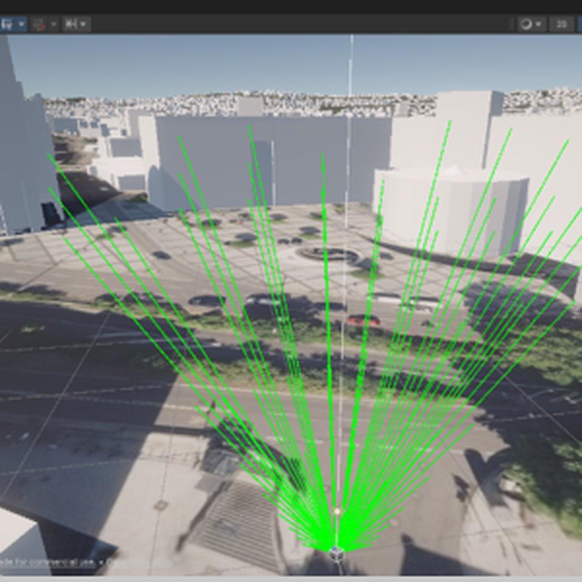
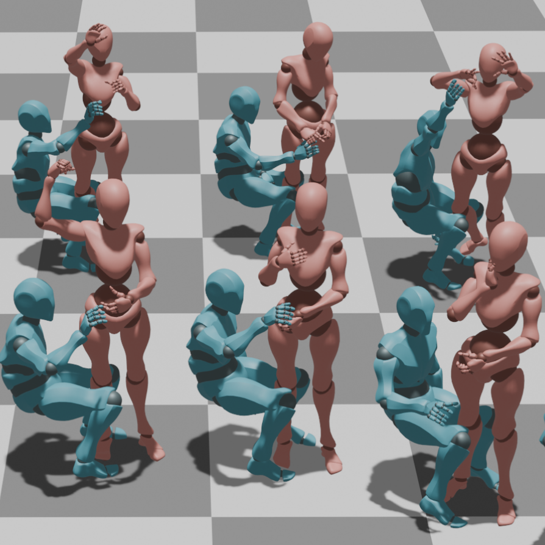
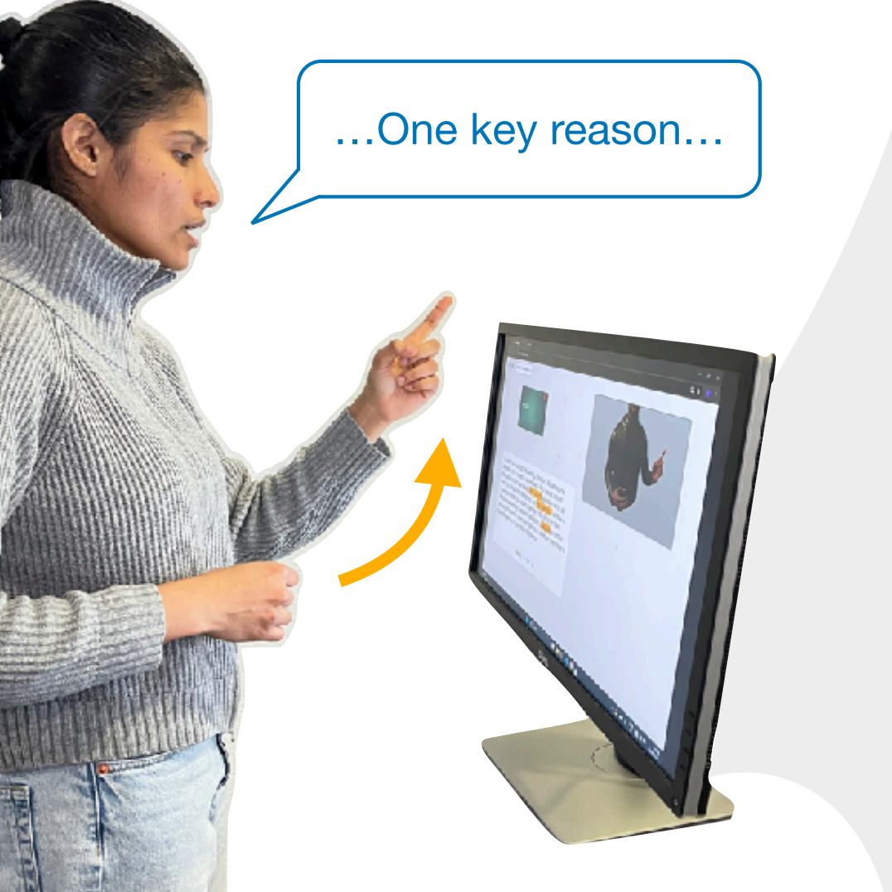

**PhD Researcher · Applied AI, Multimodal Intelligence & Embodied Systems**  
Human–Computer Interaction Lab, Saarland University

I research and engineer **AI systems that connect perception, language, decision-making, and physical interaction**. My work spans multimodal machine learning, human-centered AI, and embodied intelligence, with a focus on reliable performance in dynamic real-world environments.

I work across the full pipeline, from dataset design and model architectures to inference engineering, robot control, interactive systems, and quantitative evaluation.

## Research Focus

  

    <h3>Multimodal AI & Spatial Understanding</h3>
    
Integrating language, visual context, geometry, and temporal information to interpret intent and identify relevant targets in complex scenes.

  

  

    <h3>Embodied AI & Robot Interaction</h3>
    
Data-driven generation of naturalistic robot behavior, context-aware handovers, and supernumerary robotic limbs.

  

  

    <h3>Human-Centered AI Systems</h3>
    
Building interactive AI systems and evaluating their behavior, usability, and robustness with people.

  

  

    <h3>ML & Robotics Engineering</h3>
    
Developing model pipelines, GPU computation, ROS 2 integrations, task-space controllers, and real-time implementations.

  

## Selected Research

  <a href="/projects/speak-to-the-city/">
    
    
<strong>Speak to the City</strong>Multimodal gaze–language inference in moving vehicles · AutomotiveUI 2026 Best Paper

  </a>
  <a href="/projects/3hands/">
    
    
<strong>3HANDS</strong>Human demonstrations and naturalistic robotic handovers · CHI 2025

  </a>
  <a href="/projects/gesturecoach/">
    
    
<strong>GestureCoach</strong>Interactive LLM-supported presentation rehearsal · UIST 2025

  </a>

Explore my [Projects](/projects/) and [Publications](/publications/) for research and engineering work.

## About

I am completing my PhD at Saarland University, working at the intersection of applied machine learning, spatial reasoning, robotic interaction, and human-centered systems. My research connects technical AI methods with complete implementations and experimental validation.
