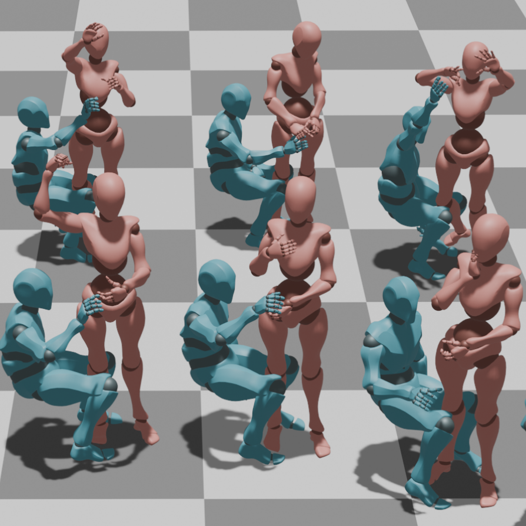
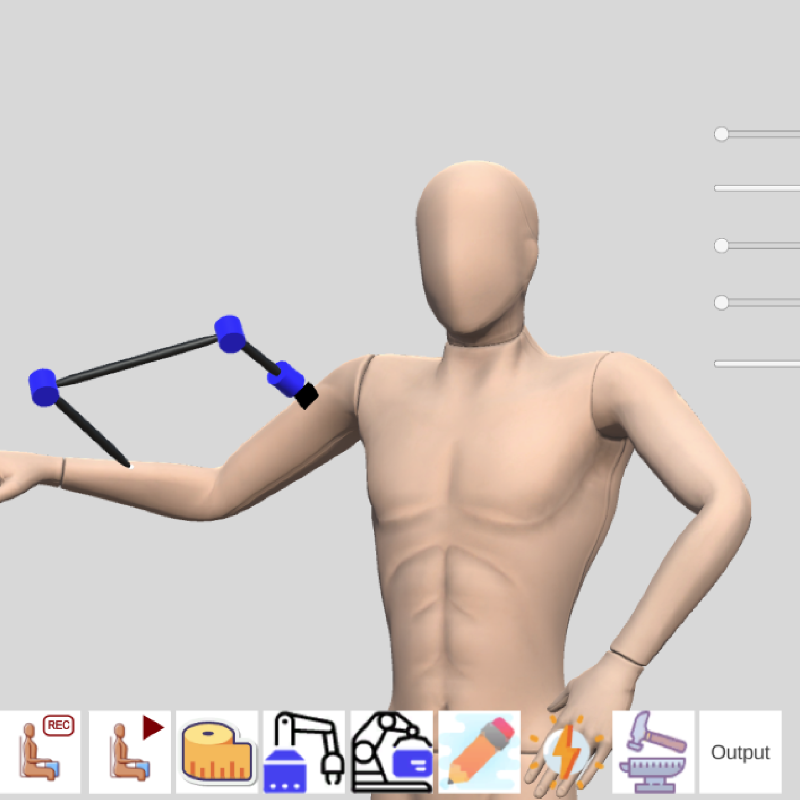
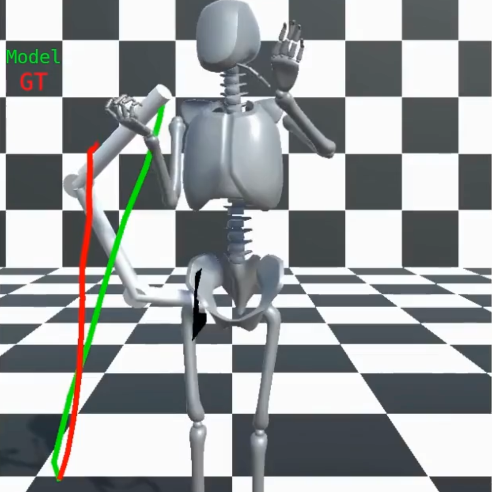
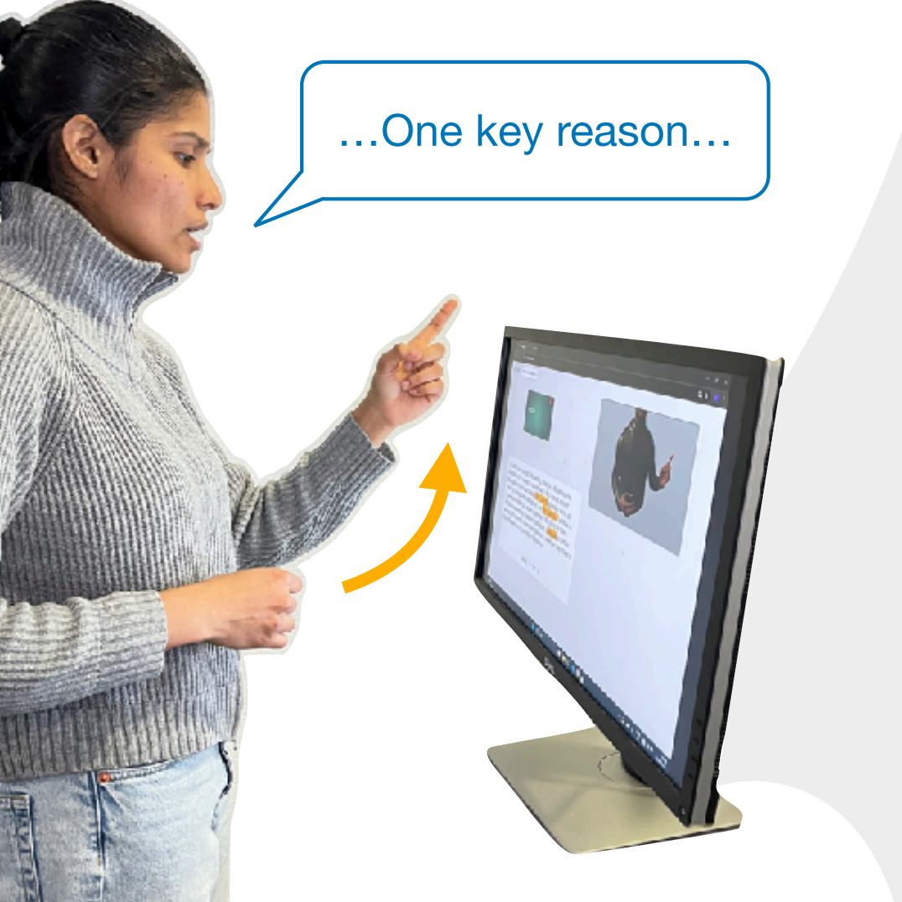
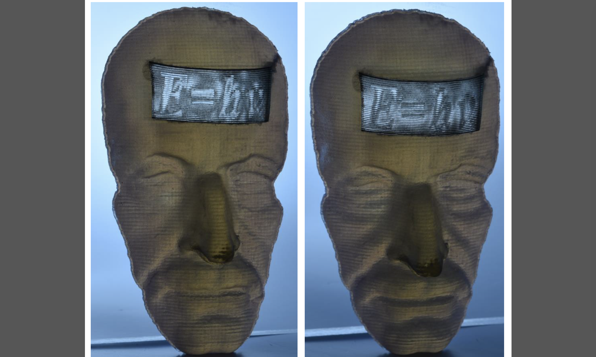
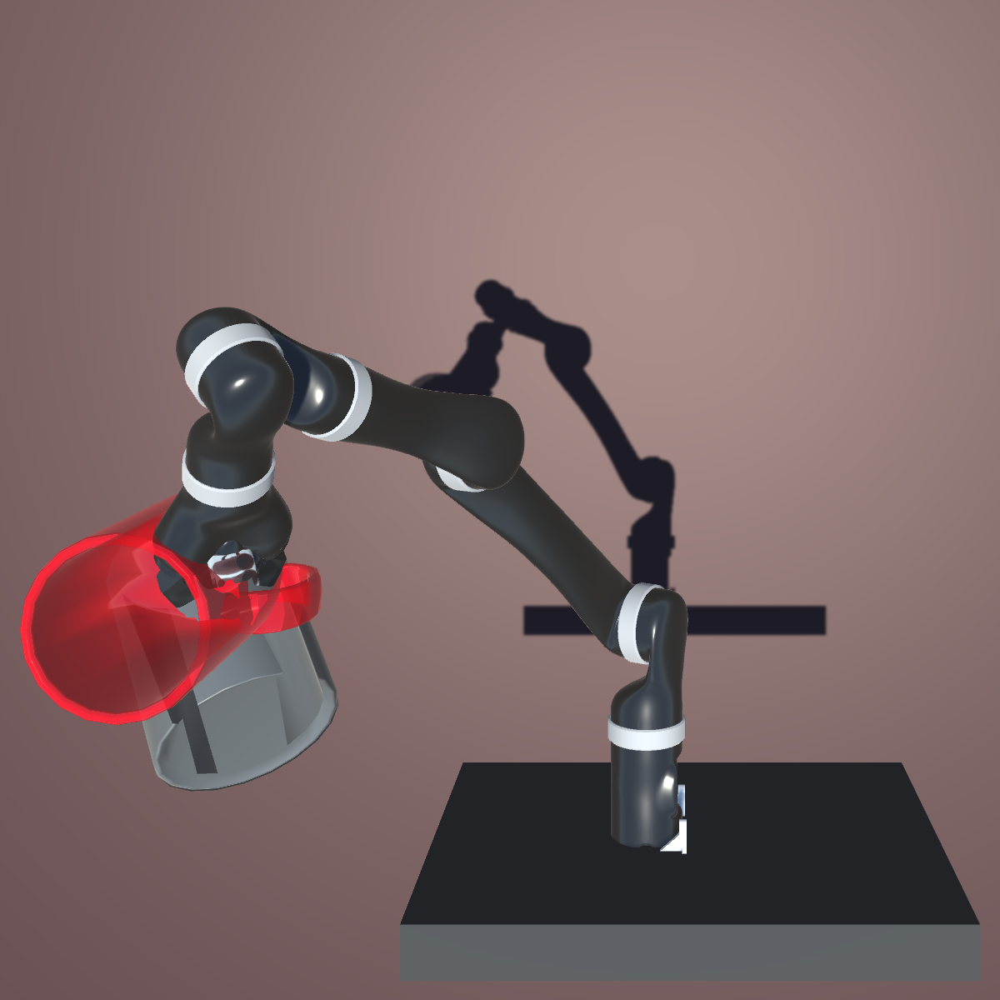

<link rel="stylesheet" href="{{ '/assets/css/research-projects.css' | relative_url }}">

<h1>Selected Research & Engineering Projects</h1>
Published research in embodied and human-centered AI, interactive systems and computational design, alongside hands-on machine learning and robotics engineering.
<h2>Research projects</h2>
<a class="project-tile" href="/projects/3hands/">
<small>Research</small><h3>3HANDS</h3>
CHI 2025 · Learning from human demonstrations

</a><a class="project-tile" href="/projects/wrlkit/">
<small>Research</small><h3>WRLKit</h3>
UIST 2023 · Personalized wearable robotic limbs

</a><a class="project-tile" href="/projects/speak-to-the-city/">
<small>Research</small><h3>Speak to the City</h3>
AutomotiveUI 2026 · Best Paper · Multimodal reference resolution

</a><a class="project-tile" href="/projects/gesturecoach/">
<small>Research</small><h3>GestureCoach</h3>
UIST 2025 · Interactive LLM-assisted rehearsal

</a><a class="project-tile" href="/projects/moire-curved-surfaces/">
<small>Research</small><h3>Fabrication of Moiré on Curved Surfaces</h3>
Optics Express 2020 · Computational optics and fabrication

</a>
<h2>Engineering projects</h2>
<a class="project-tile" href="/projects/mini-ctorch/">
<small>Engineering</small><h3>Mini_CTorch</h3>
C/CUDA · GPU kernels, autograd and training

</a><a class="project-tile" href="/projects/srl-impedance-control/">
<small>Engineering</small><h3>SRL Impedance Control</h3>
MuJoCo · Six-DoF robot impedance control

</a>

